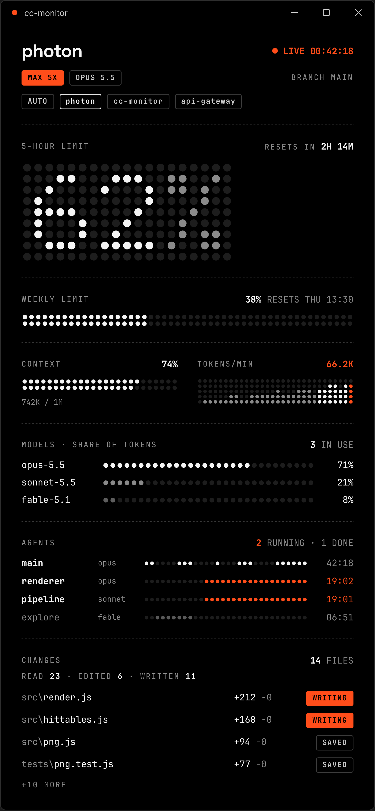
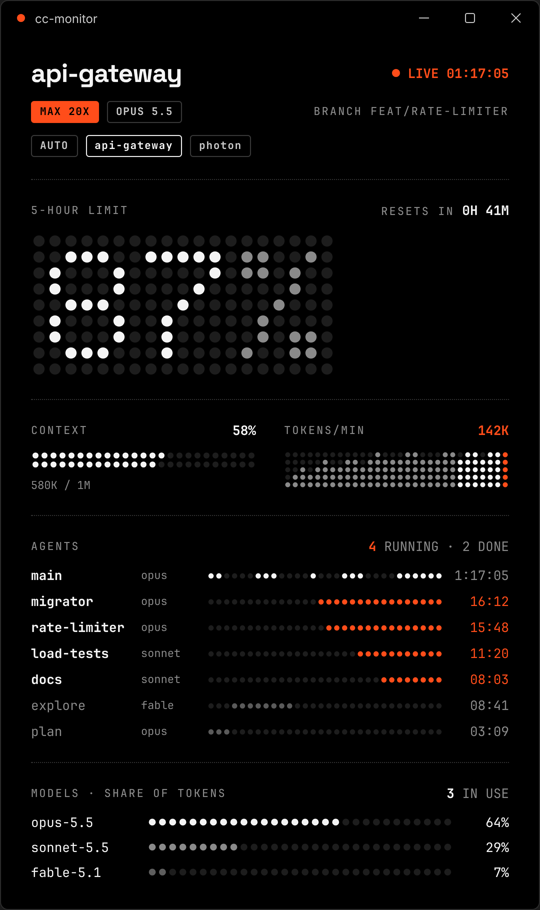
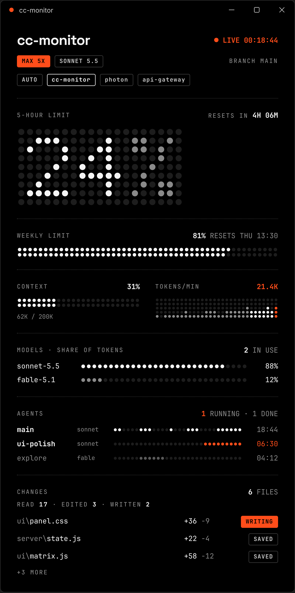
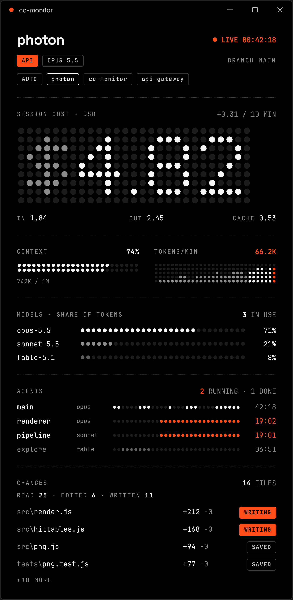
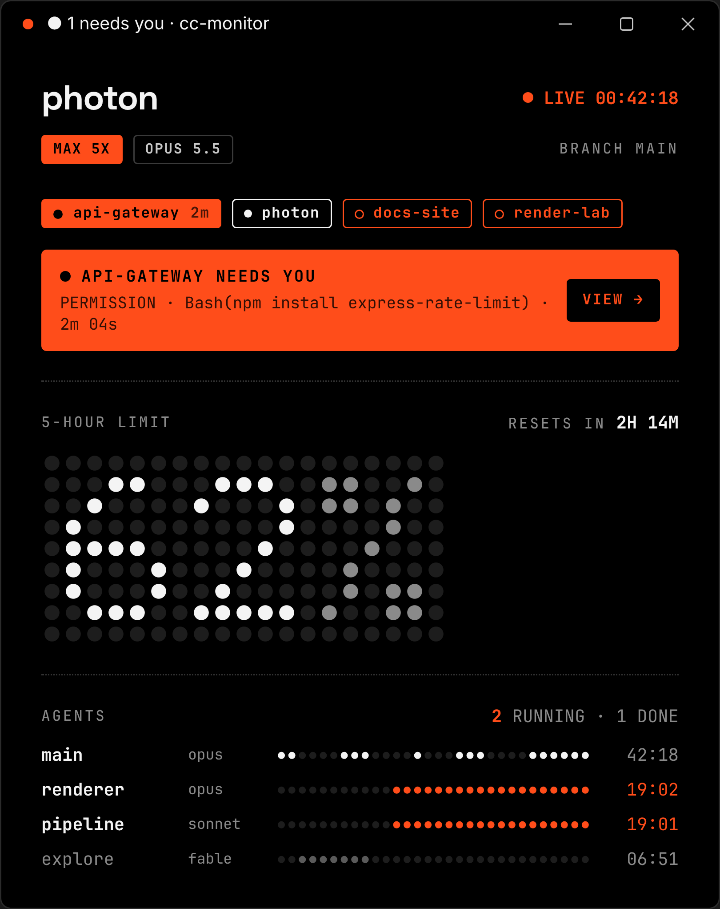
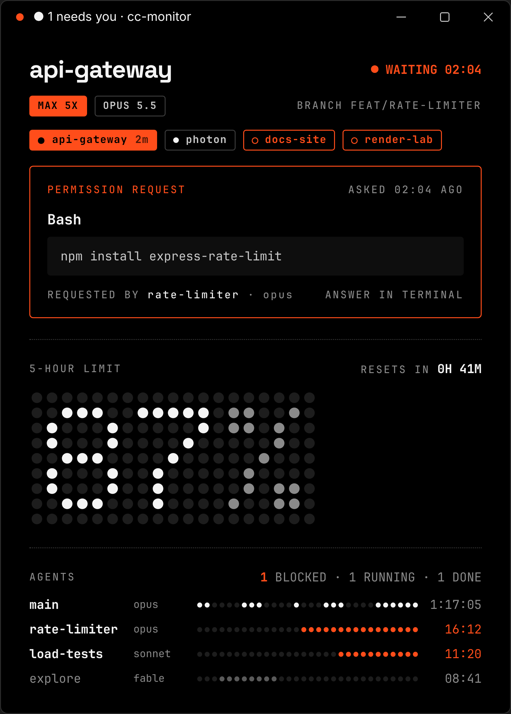

# cc-monitor

[](https://www.npmjs.com/package/cc-live-monitor)


A live session monitor for [Claude Code](https://claude.com/claude-code) that runs in its own small window next to your terminal. Every display is a dot-matrix readout: your subscription limits, context, tokens per minute, models, agents and file changes, all updating as Claude works.

## Quick start

```sh
npx cc-live-monitor install   # once: adds the hooks + status line to Claude Code
npx cc-live-monitor           # start the monitor window
```

Then use Claude Code as usual (`claude`, `claude --continue`, `claude --resume`). The window follows whichever session is active.

Prefer a short command? Install it globally:

```sh
npm install -g cc-live-monitor
cc-monitor install
cc-monitor
```

To remove it: `npx cc-live-monitor uninstall` (or `cc-monitor uninstall`).

<p align="center">
  
</p>

| Parallel subagents | Heavy week | API plan *(concept)* |
|:---:|:---:|:---:|
|  |  |  |
| Six agents, each with its own model and a dot per minute | Weekly limit at 81%, a 200K context window | Design concept only. v0.1 shows usage, not cost |

It shows subscription usage, not dollar cost. No dollar figures appear anywhere in v0.1.

| Section | What it shows |
|---|---|
| Header | Project, LIVE + session timer, plan chip (PRO / MAX / TEAM / API), main model, git branch, session switcher when several are active |
| 5-hour limit | Big dot-matrix % and time until reset |
| Weekly limit | 100-dot strip, % and reset day/time |
| Context | % of the context window used, tokens used / window size |
| Tokens/min | Equalizer for the last 30 minutes. The newest minute pulses |
| Models | Every model used this session (main + subagents) and its share of tokens |
| Agents | Main plus every subagent, including parallel ones: its name, model, a dot per minute (running = accent, done = grey) and its own elapsed time. All agents are kept; the list scrolls after about 12 rows |
| Changes | Files read / edited / written, +/− lines, WRITING while a write is in flight, SAVED after |

## Needs you

With several sessions open it's easy to lose track of which one is waiting on you. Each session tab shows its state:

| Another session needs you | This session is blocked |
|:---:|:---:|
|  |  |
| Alert strip on every view, with VIEW → to jump there | Permission card with the exact command and the agent that asked |

| Tab | State | Meaning |
|---|---|---|
| solid orange, pulsing, with wait time | **NEEDS YOU** | A permission prompt, or Claude is idle waiting for your input. Sorted first |
| orange outline, hollow dot | **YOUR TURN** | Claude finished its reply |
| white blinking dot | **WORKING** | Tools or tokens flowing |
| dimmed | **IDLE** | No activity for 10 minutes. Leaves the bar after 30 minutes |

When any session needs you:

- An **alert strip** shows on every view, for example `API-GATEWAY NEEDS YOU · PERMISSION · Bash(npm install express-rate-limit) · 3m 12s`, with **VIEW →** to jump to it. Several blocked sessions stack, oldest first.
- On the blocked session itself, the header timer becomes a blinking **WAITING mm:ss**. A request card shows the tool, the exact command, and which agent asked ("REQUESTED BY rate-limiter · haiku"). Answer in your terminal.
- The window title becomes **● 2 needs you · cc-monitor**, so it shows on the taskbar.
- Optional desktop notifications: `cc-monitor notify on`. They fire once per block, only while the monitor window isn't focused. The first time, click **ENABLE NOTIFICATIONS** in the window.

A pending permission stays NEEDS YOU until it's answered. A wait for input turns into IDLE after 10 minutes. Everything clears as soon as you respond.

## What `install` changes

Requires Node 18+ and Claude Code. Restart any Claude Code sessions that were already running so they pick up the hooks.

`install` first backs up `~/.claude/settings.json` to `~/.cc-monitor/backups/`. It then:

- copies two small forwarder scripts to `~/.cc-monitor/bin/` (a stable path, so the hooks keep working even after the npx cache is cleared)
- appends one hook entry for `SessionStart`, `UserPromptSubmit`, `PreToolUse`, `PostToolUse`, `PermissionRequest`, `Notification`, `SubagentStop`, `Stop` and `SessionEnd`. Your existing hooks are left alone
- sets `statusLine` to cc-monitor's script. If you already had a status line, it is remembered and **chained**: yours still runs and its output is what you see

Running `install` again is safe. It never adds duplicates, and it adds any hooks a newer version needs. That's how you upgrade.

## Uninstall

```sh
npx cc-live-monitor uninstall
```

This removes only cc-monitor's hook entries and puts your previous status line back (or removes the key if you had none). A backup is taken first. You can then delete `~/.cc-monitor/`.

## Other commands

```sh
cc-monitor plan max      # override the plan chip (pro | max | team | api | auto)
cc-monitor notify on     # desktop notification when a session needs you (off by default)
cc-monitor notify off
cc-monitor status        # installed? running? detected plan
cc-monitor --no-open     # server only
cc-monitor --capture     # also log raw payloads to ~/.cc-monitor/capture.jsonl
```

The port is `4317` (localhost only). Set `CC_MONITOR_PORT` to change it.

## How it works

```
Claude Code ──status line JSON──▶ statusline.js ──POST /status──┐
            ──hook JSON─────────▶ hook.js       ──POST /hook────┤
            ──writes transcripts (JSONL)─────────── tailed ─────┤
                                                                 ▼
                                    cc-monitor server (127.0.0.1:4317)
                                                                 │ WebSocket
                                                                 ▼
                                       app-mode window (Edge / Chrome)
```

- **Status line**: Claude Code pipes session JSON to the status line command. It carries `rate_limits.five_hour` / `seven_day` (`used_percentage`, `resets_at`), `context_window.*` and `model`. The script forwards it (300 ms timeout) and prints your status line, or a short one of its own. The `cost` block is dropped on arrival.
- **Hooks**: one script for every event. It POSTs stdin to the server and exits 0 right away (300 ms request timeout, 1.5 s hard ceiling). It prints nothing and fails silently when the server is down, so it never blocks Claude. Subagents are recorded when the `Agent`/`Task` tool is called (type, description, model) and finish on `SubagentStop`. If that never arrives, a subagent is done once its transcript has been silent for 3 minutes, unless it's waiting on a permission, or when its session ends.
- **Needs you**: `PermissionRequest` (`tool_name`, `tool_input`, `agent_id`/`agent_type` when a subagent asks) and `Notification` (`notification_type`: `permission_prompt` / `idle_prompt`) start a wait. `Stop` means your turn. `UserPromptSubmit`, or any tool event from the same agent, clears it. Claude Code re-runs the status line the moment a prompt is answered, so an approved slow command clears right away, not when it finishes.
- **Transcripts**: the server tails the session JSONL and every `subagents/agent-*.jsonl`. Each subagent's `.meta.json` links it to the `Agent` call that spawned it, which keeps parallel subagents apart. Token usage is summed from `message.usage` on assistant entries, per model and per minute. Entries are deduplicated by `message.id`, because Claude Code writes one entry per content block. "Tokens" means input + cache-write + output. Cache reads are left out, since counting them would re-count the whole context on every turn. Set `"countCacheReads": true` in `~/.cc-monitor/config.json` to include them.
- **Plan**: read from `oauthAccount.organizationType` / `organizationRateLimitTier` in `~/.claude.json`. Only those fields are read, and the credentials file is never opened. `cc-monitor plan <name>` overrides it.
- **Sessions**: the window follows the most recently active session. A switcher appears when several are active. A session disappears when it ends: on the `SessionEnd` hook, or when its Claude Code process is gone (checked through `~/.claude/sessions/<pid>.json`). Idle sessions leave the bar after 30 minutes.
- Sessions already running when cc-monitor starts are picked up from their transcripts.
- Headless (`-p`) runs don't call the status line, so their context window size shows as "—". Missing values always show "—".

## Development

```sh
npm install
npm test          # install/uninstall round trip + unit tests (state machine, agents, glyphs)
node bin/cc-monitor.js
```

## Changelog

### 0.2.0
- **Needs you**: session tabs show NEEDS YOU / YOUR TURN / WORKING / IDLE. Alert strip with VIEW →, a permission request card with the exact command and the agent that asked, a WAITING header timer, a window title count, and optional desktop notifications (`cc-monitor notify on`).
- New hooks: `UserPromptSubmit`, `PermissionRequest`, `Notification`. Re-run `install` to add them.
- Agents: elapsed is each agent's own start to end, never the session's. Agents finish on `SubagentStop`, after 3 minutes of transcript silence, or when the session ends. A server restart no longer brings finished agents back as running (no more 280h timers).
- Agents: every agent is kept. Running and blocked first, then finished ones newest first. Totals in the header, and the list scrolls inside its section.
- Agents show their real name when the payload has one, otherwise `type·id` (for example `general-purpose·3f9`).
- Main agent timer counts the current run, so a resumed session doesn't count from days ago.
- 5-hour display: every glyph has its own columns with a 1-column gap.
- Deep link: `http://127.0.0.1:4317/?session=<id>`.

### 0.1.0
- First release.

## License

MIT
